<p align="center">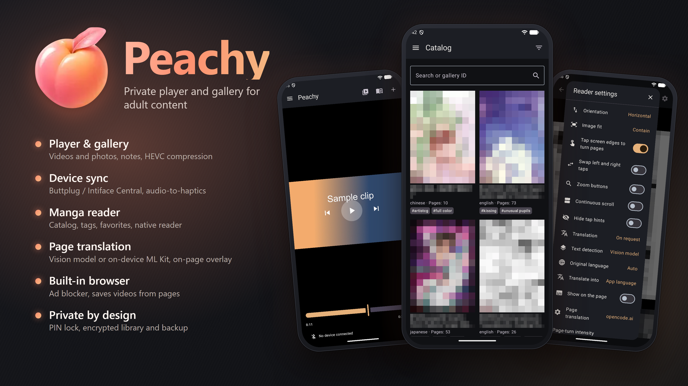</p>

# Peachy

Private player and gallery for adult content: videos, image galleries and hentai manga in one app. It syncs playback with devices through the Buttplug protocol (Intiface Central). Native Android, Jetpack Compose. Version in this tree: `3.3.0` (`versionCode` 8). [Русская версия](README_RU.md).

Screenshots use sample clips. Catalog covers and titles are pixelated, and the reader shot shows its settings dialog over a pixelated page.

## Overview

| Area | What you get |
|---|---|
| Player and devices | Local video on Media3 ExoPlayer, with playback speed and a timer that switches videos. Audio amplitude goes through one DSP path (bass range, smoothing, threshold, power boost) and drives vibration, oscillation, rotation or position on devices connected through Intiface Central. |
| Library | Mixed photo/video gallery with swipeable tabs, albums, header search, name/size sorting, size filters and adjustable tiles. Rename/delete either type and zoom photos full-screen. Videos also support cover replacement, folder export, single/batch HEVC/H.264 compression and private notes. |
| Browser | Tabs, bookmarks, history and an ad and tracker blocker. It lists the video files a page loads and saves a chosen one to the library; HLS and DASH streams cannot be saved. A page's audio can drive haptics. |
| Manga | nhentai in a native app: a catalog with tag filters, a tag browser with favorites and collections, a For you tab computed on the device, history, saved galleries, and a native reader with zoom, a thumbnail strip and saved pages. Tag names are shown in Russian when the interface is Russian. |
| Privacy and backup | A non-empty password of any length with a growing wait after failures; SQLCipher database and `FLAG_SECURE` windows. Rotation preserves an unlocked session; leaving the app locks it. Export/import the library as a password-protected `.peachy` file. |
| Languages | Russian and English, dark interface. |

## Screenshots

### Player and library

| Onboarding | Password | Player |
|:---:|:---:|:---:|
| 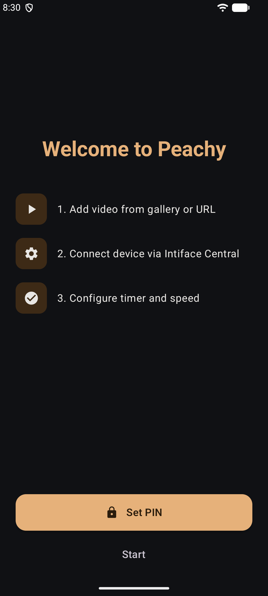 | 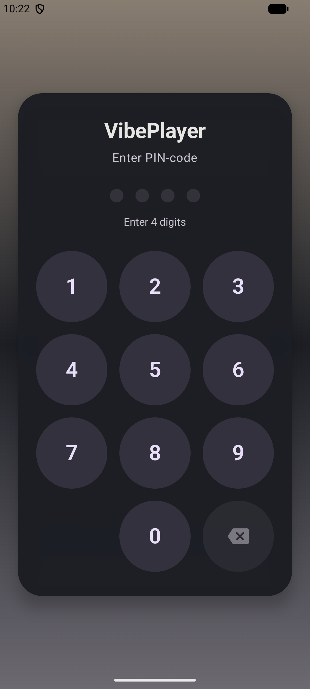 | 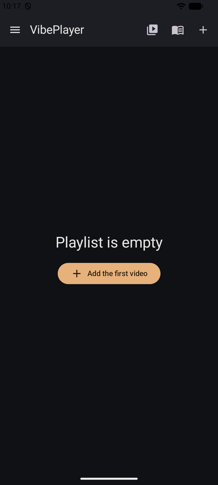 |

| Settings | Device | Add video |
|:---:|:---:|:---:|
| 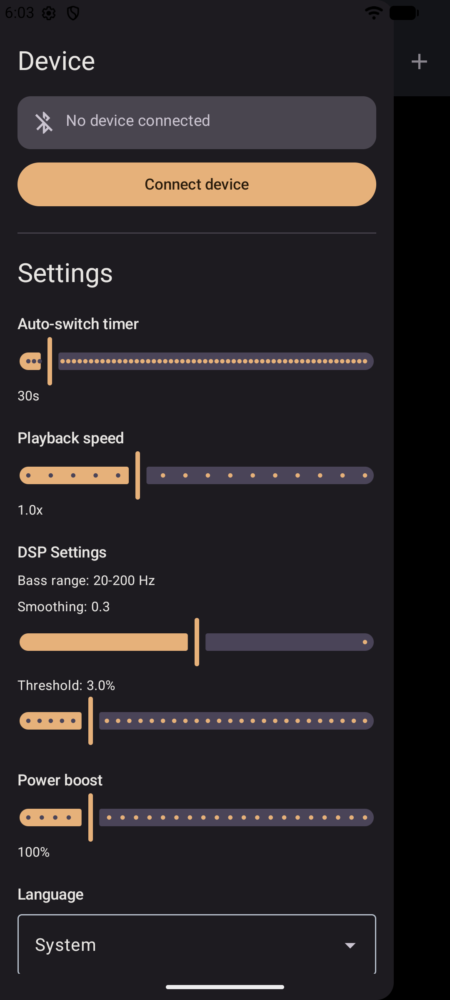 | 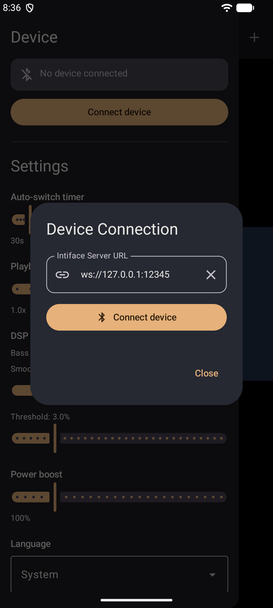 | 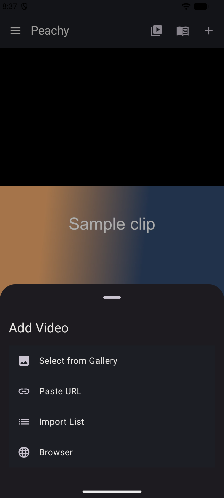 |

| Gallery | Compress | Note |
|:---:|:---:|:---:|
| 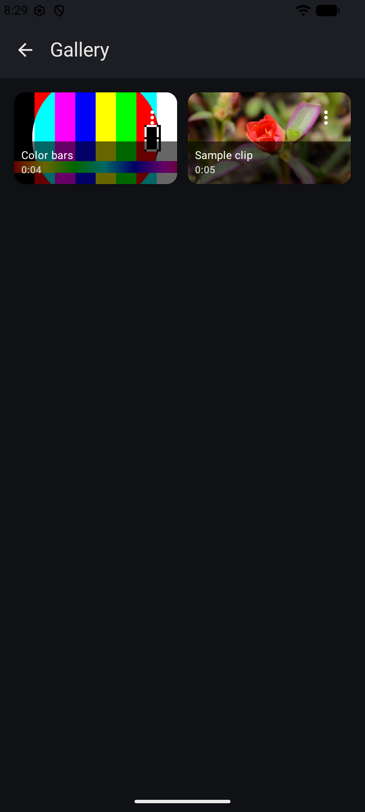 | 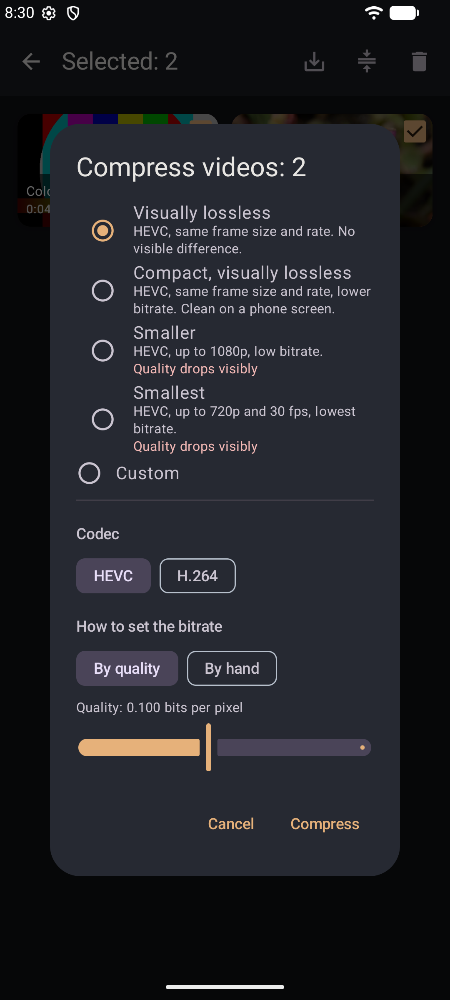 | 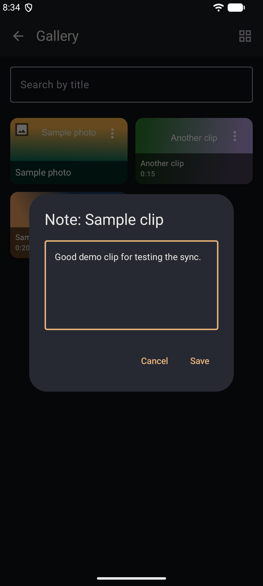 |

| Gallery layout | Download | More settings |
|:---:|:---:|:---:|
| 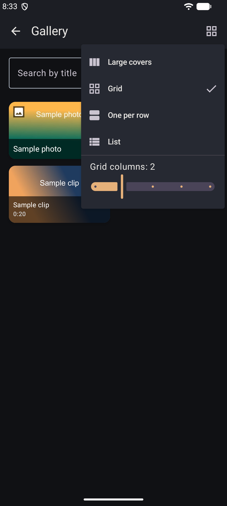 | 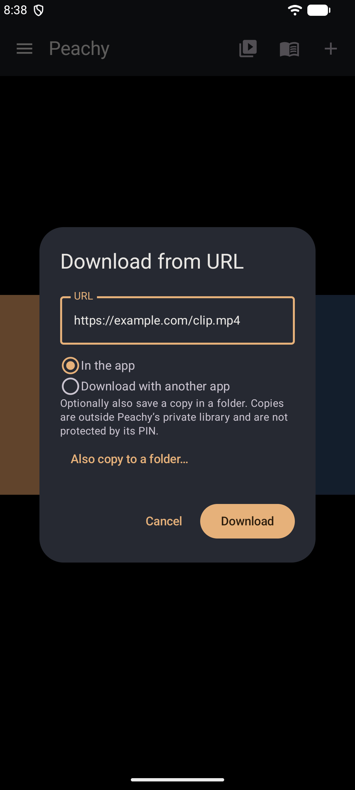 | 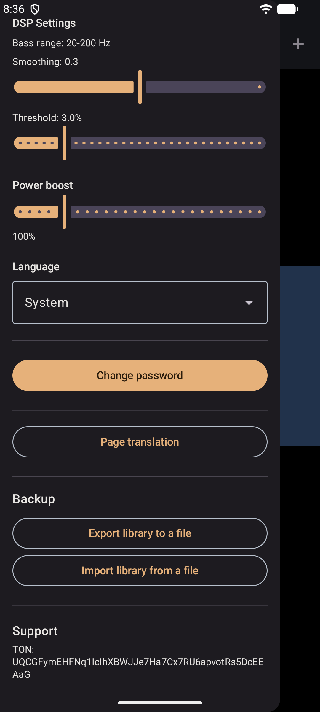 |

### Browser and backup

| Start page | Page videos | Backup |
|:---:|:---:|:---:|
| 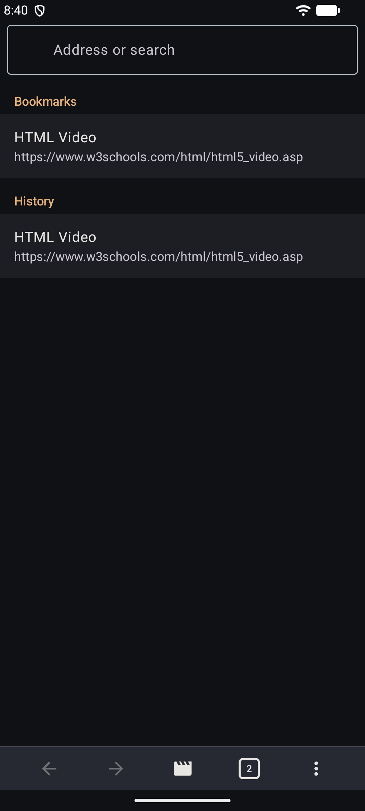 | 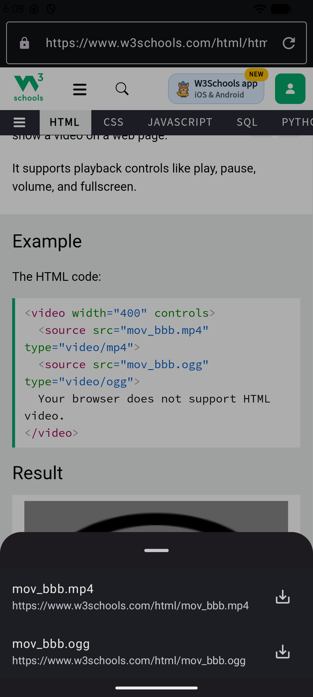 | 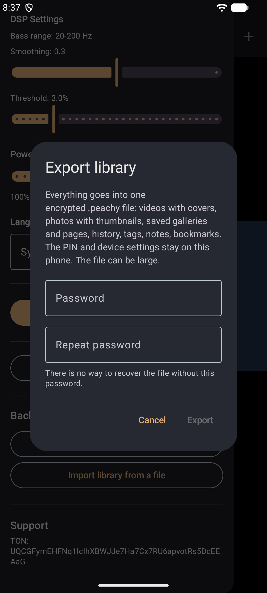 |

| Browser menu |
|:---:|
| 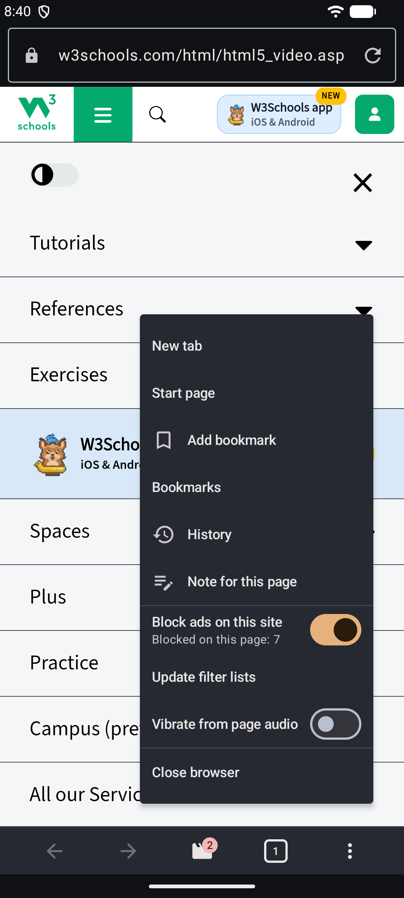 |

### Manga

| Catalog | Menu | Tags | Reader |
|:---:|:---:|:---:|:---:|
| 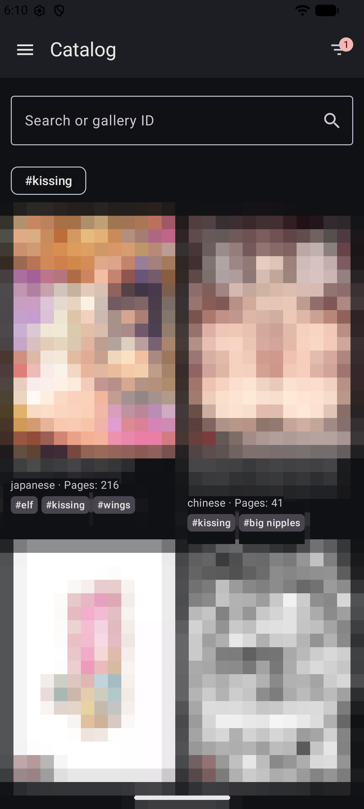 | 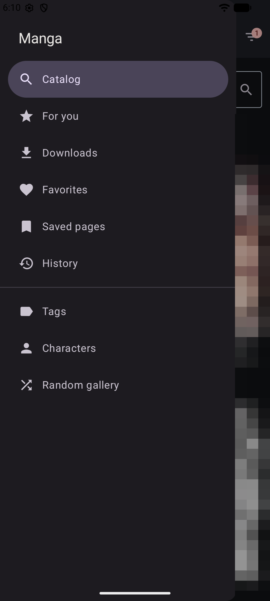 | 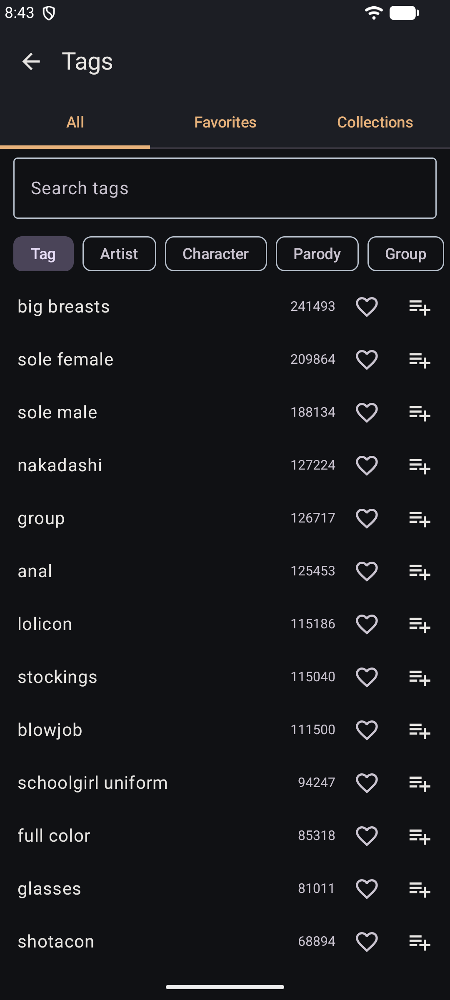 | 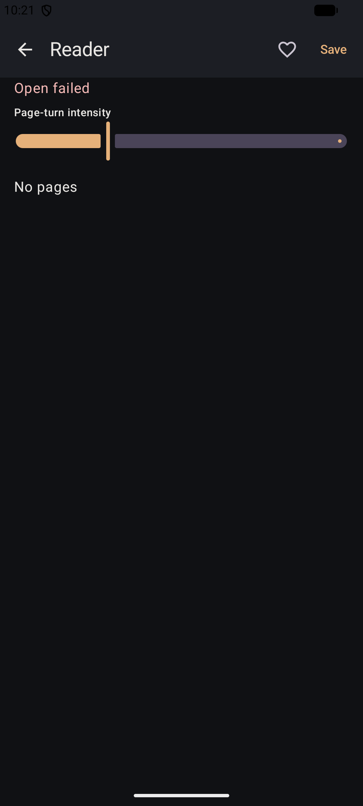 |

| Page translation provider |
|:---:|
| 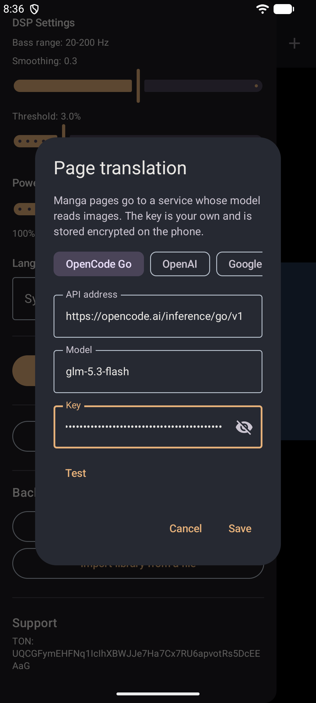 |

## Details

- Plays local video with Media3 ExoPlayer. A thumbnail carousel shows the actual playback queue and highlights the selected clip. Swipe the video horizontally to seek; double-tap the left/right half for −10/+10 seconds. Vertical swipes on the left/right edge adjust window brightness/media volume. Pinch to zoom, drag while zoomed to pan, and long-press to reset zoom. Carousel drags only scroll the queue.
- Search sits in the gallery, player and manga catalog headers. Media title search ignores case; sorting supports newest, name and file size in both directions. Inclusive size bounds are entered in MiB. Player search/filters change the queue. Manga search keeps gallery-ID navigation.
- Gallery tabs (All, Videos, Photos, Albums) support horizontal swipes. Cards show stored file sizes. Rename/delete either media type, including a mixed selection; photo tiles open an EXIF-aware pinch-zoom/pan viewer, never the player. Compression and folder export remain video-only.
- A photo or video belongs to at most one album. Create/rename albums and move individual or mixed selected media, including back to “Not in an album”. Deleting an album leaves all its files in the library.
- Receives one or several photos or videos through Android Share. Photos are copied into private internal storage, checked by decoding image bounds, and given downscaled thumbnails. Each photo is limited to 100 MiB, including when the sharing app reports no size; invalid images are rejected. Missing or unusual display names do not become storage paths.
- The gallery layout menu remembers the cover style and a discrete tile-size setting of 1–5 columns. The setting applies immediately to grid layouts; One and List stay single-column without discarding the grid setting.
- Downloads a video from an `http` or `https` URL into the app library.
- Imports videos from file-host links: an album or a single file on Bunkr, Cyberdrop, Turbo, Pixeldrain or Filester, or a findr.to album page (imported from the album it points to). An album link brings every video in it; images and archives are skipped. Only public links work: password albums, GoFile and FileDitch are not supported. Turbo's CDN could not be reached from the test machine, so Turbo downloads are untested.
- Exports selected gallery videos to a folder you choose. The app gets access to that folder only, and a failed copy is removed instead of left half-written.
- Compresses a single video from its menu, selected videos, or the current filtered gallery videos with Media3 Transformer. Four presets or custom codec, bitrate, height, frame rate and audio; a size estimate appears before starting. Unsupported HEVC output falls back to H.264. The original is replaced only when the result is smaller and passes size/duration/audio checks. Cancellation leaves originals untouched.
- Opens an HTTPS page in a WebView and uses that page's audio for haptics. The window is marked `FLAG_SECURE`. Non-HTTPS pages are rejected.
- Has a built-in browser with tabs, bookmarks, history and an ad and tracker blocker. The blocker uses EasyList, EasyPrivacy and an adult list bundled in the app; "Update filter lists" in the menu fetches fresh copies. Blocking can be turned off per site. The browser lists the video files a page loads and saves a chosen one to the library; HLS and DASH streams cannot be saved. Pages open over HTTPS only.
- Translates a manga page in the native reader with a vision-language model of your choice, over an OpenAI-compatible `chat/completions` API (the default points at OpenCode Go with `glm-5.3-flash`; one tap fills in the address and a cheap model for OpenCode Go, OpenAI, Google Gemini, OpenRouter or Mistral; set the address, model and key in Settings, "Page translation", or from the panel). A button in the reader header sends the current page; the result shows in a panel over the bottom of the page: each line with its translation, original and sound-effect markers. The mode is set in the reader settings: on request, on every page turn, or the whole gallery with progress and Cancel. The language is the app language (the device language if it is set to System). Translations are cached per gallery, page and language in the encrypted database and travel in the `.peachy` file, so a page is paid for once. A 401, 403 or 429 stops a batch instead of retrying. The reader settings also choose the source language (Auto, Japanese, Chinese, Korean, English), the target language (the app language by default) and the text detection: the model finds the text itself (best with a strong vision model), or ML Kit finds it on the device and only the recognised text goes to the provider (Latin, Japanese, Chinese and Korean; adds about 15-30 MB). "Show on the page" draws each line on a white plate over its original text, and the plates move with zoom and pan.
- Sends page images to the provider address you entered, and nowhere else, only after you accept a prompt that names the host. Changing the host asks again. Plain `http` is accepted only for localhost and private networks. The key is kept encrypted on the phone (`EncryptedSharedPreferences`), is never written to the database, the `.peachy` file or a backup, and is not logged. Adult content is sent as it is: a provider may refuse some pages, and the panel says so.
- Keeps a private note on a video, a saved gallery or a browser page. Notes live in the encrypted database and are never sent anywhere.
- Exports/imports the library as a password-protected `.peachy` file: media and thumbnails, albums, saved manga/pages, histories, tags/blacklist, notes, browser data and cached translations. AES-256-GCM with a PBKDF2-SHA256 key; files stream in blocks. Format 3 reads formats 1 and 2. Album IDs are remapped; matching names and creation times are paired one-to-one, so distinct same-name albums stay separate. Duplicate local media keeps its existing album. Import adds rather than deletes; newer notes/translations win. Photo duplicates use title, pixel dimensions and file size. App password, device settings and provider key stay on the device. A forgotten vault password cannot be recovered.
- Connects to Intiface Central over a WebSocket. The default address is `ws://127.0.0.1:12345`. The app does not scan Bluetooth itself; Intiface does that.
- Maps audio amplitude through one DSP path: bass range, smoothing, threshold, and power boost. The same settings apply to the player and the WebView.
- Sends commands only to actuators that can follow an audio level, such as vibration, oscillation, rotation, and position.
- Switches videos on a timer and changes playback speed.
- Locks with any non-empty password without trimming or a fixed length; existing PINs continue to work. Change it from Settings. Repeated failures increase the wait. Lock/setup/change screens scroll with the keyboard and fit landscape. Configuration changes keep the live unlocked session; a genuine background transition locks it.
- Speaks Russian and English. The interface is dark.
- Browses nhentai in a drawer-based hub: Catalog, Downloads, Favorites, History, Tags, Characters, and Random gallery. The catalog is a two-column cover grid with tag chips, filters by tag (include or exclude), date, and page count, and sorting by date or popularity. The tag browser lists tags, artists, characters, parodies, groups, categories, and languages by popularity; tags can be marked favorite, put into named collections kept on the device, and sent to the catalog as a search. A gallery page shows titles, page count, favorite count, upload date, tags grouped by type, related galleries, and read-only comments loaded on demand. Posting comments needs an nhentai account and is not available. Galleries open in a native Compose reader and can be saved on the device and marked favorite. Page images are requested from `i1.nhentai.net` and `t1.nhentai.net` without rewriting the path returned by the API. Turning a page sends a short pulse. Page-turn strength is configured in the reader settings sheet, not with a slider on the page.
- In the catalog the Filters button sits in the title bar and shows how many tags are active. Tapping a tag on a card cycles it through include, exclude, and removed, the same order as the chips under the search field; a long press marks the tag as a favorite and highlights it on every card. The next page is appended while you scroll toward the end of the list, and a failed page shows a Retry button instead of reloading by itself.
- With the Russian interface, tags, categories, and gallery languages are shown in Russian: a built-in dictionary covers the tags used by at least 500 galleries, and any other name stays in English. Search, filters, favorites, and tag collections always use the English names the API uses, so switching the language changes only what is drawn.
- Recommends galleries in a For you tab, computed on the device. It learns from the galleries you open, read, save, and favorite, from your favorite tags and tag collections, and from "Not interested" taps, with older signals fading over time. Candidates come from nhentai searches by your top tags and from the related lists of galleries you liked; each pick shows the tags that earned it a place. Until there is some taste to go on, the tab shows what is popular. The upload date appears on a card only for galleries whose page the app has already opened, because search results do not carry it. History uses the same large cards as the catalog. A gallery page shows a grid of page previews under the tags, and a tap opens the reader at that page.
- The native reader turns pages by tapping the left or right third of the screen (or the top and bottom third in vertical paged mode; the continuous strip keeps left and right); the middle shows the title bar, a strip of page thumbnails, and the settings sheet. Settings: reading direction (vertical or horizontal), image fit (whole page or full width), continuous scroll, tap navigation with a left/right swap for one-handed use, zoom buttons, and hiding the tap hints that show when the reader opens. Pinch, double tap and the zoom buttons enlarge a page up to 6x, and the next three pages load in advance. The reader resumes at the last page you read. The bookmark button in the title bar keeps a single page; the Saved pages tab lists those pages, opens the reader on one, and exports or deletes a selection. Exported pages go to a folder you choose, and the app gets access to that folder only.

- Support in Settings copies the Sol address `FB4B37LCd52dgVED5fR7Vj7CDttsa74CQyBc647agQP7`; the GitHub button opens [spgsroot/Peachy](https://github.com/spgsroot/Peachy). `repo/logo.svg` is the scalable logo source for launcher, splash and banner exports.
- Verification and emulator limitations: [manual usability report](docs/reports/2026-11-14-usability.md).

The nhentai key is compiled into the client and sent only in the `Authorization` header. It is in the public source and can be read from the APK. Minify is off in the release build type.

## Requirements

- minSdk 26, targetSdk 36
- JDK 17 and an Android SDK for a local build
- Intiface Central, if a device should move

## Build

```bash
./gradlew :app:assembleDebug
```

`assembleRelease` produces an unsigned APK. The GitHub Actions workflow `.github/workflows/release.yml` signs the release with repository secrets. It runs on a `v*` tag or when started by hand. This checkout has no `LICENSE` file.
