<p align="center">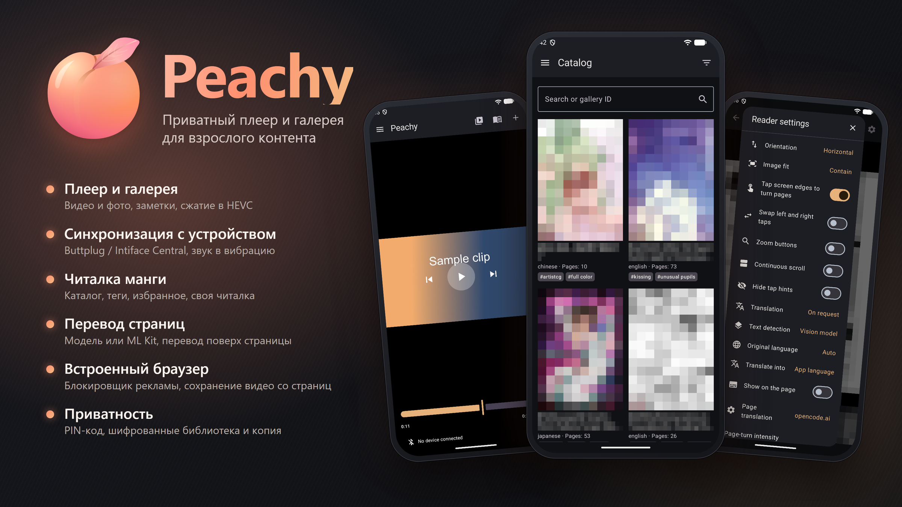</p>

# Peachy

Приватный плеер и галерея для взрослого контента: видео, галереи изображений и хентай-манга в одном приложении. Синхронизация воспроизведения с устройствами через протокол Buttplug (Intiface Central). Нативное приложение для Android, Jetpack Compose. Версия в этом дереве: `3.3.0` (`versionCode` 8). [English](README.md).

На снимках — тестовые ролики. Обложки и названия в каталоге закрыты мозаикой, а снимок ридера показывает диалог настроек поверх страницы, закрытой мозаикой.

## Обзор

| Область | Что есть |
|---|---|
| Плеер и устройства | Локальное видео на Media3 ExoPlayer, скорость воспроизведения и таймер смены роликов. Амплитуда звука идёт через один DSP-тракт (диапазон низких частот, сглаживание, порог, усиление) и управляет вибрацией, осцилляцией, вращением или позицией на устройствах, подключённых через Intiface Central. |
| Библиотека | Общая галерея фото и видео: вкладки со свайпами, альбомы, поиск в шапке, сортировка по имени и весу, фильтр размера и настройка плиток. Переименование, удаление, полноэкранный просмотр фото. Для видео — смена обложки, выгрузка в папку, одиночное/групповое сжатие HEVC/H.264 и личные заметки. |
| Браузер | Вкладки, закладки, история, блокировщик рекламы и трекеров. Показывает видеофайлы, которые загрузила страница, и сохраняет выбранный в библиотеку; потоки HLS и DASH сохранить нельзя. Звук страницы может управлять вибрацией. |
| Манга | nhentai в нативном приложении: каталог с фильтрами по тегам, браузер тегов с избранным и подборками, вкладка «Для вас», которая считается на устройстве, история, сохранённые галереи и нативный ридер с зумом, лентой миниатюр и сохранёнными листами. В русском интерфейсе названия тегов показываются по-русски. |
| Приватность и резервная копия | Непустой пароль любой длины с растущей паузой после ошибок, база SQLCipher и окна с `FLAG_SECURE`. Поворот сохраняет разблокированную сессию, уход из приложения блокирует её. Библиотека переносится в файле `.peachy` под отдельным паролем. |
| Языки | Русский и английский, тёмная тема. |

## Скриншоты

### Плеер и библиотека

| Первый запуск | Пароль | Плеер |
|:---:|:---:|:---:|
| 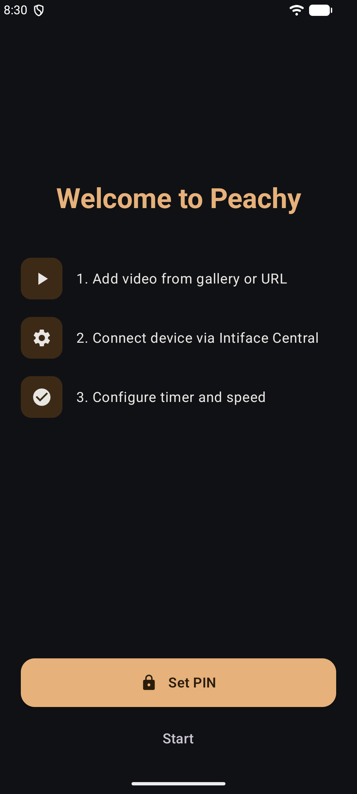 | 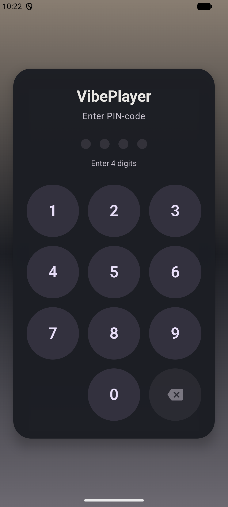 | 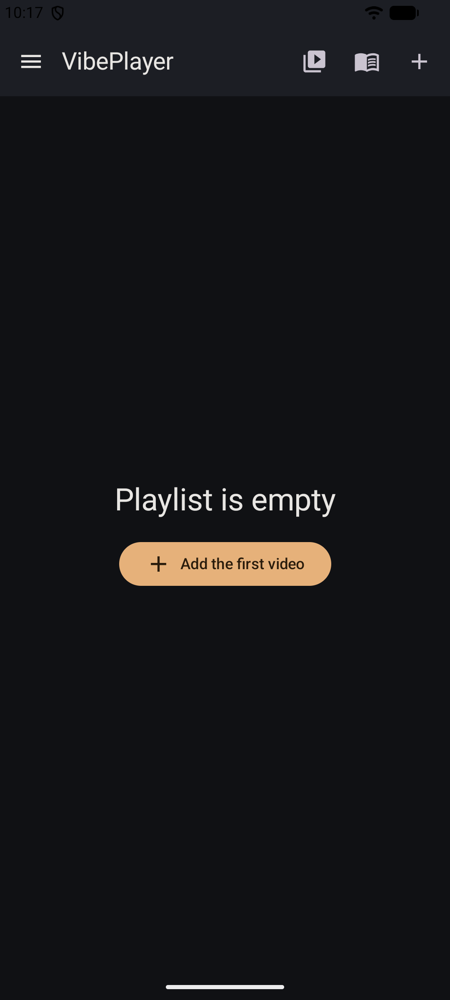 |

| Настройки | Устройство | Добавление видео |
|:---:|:---:|:---:|
| 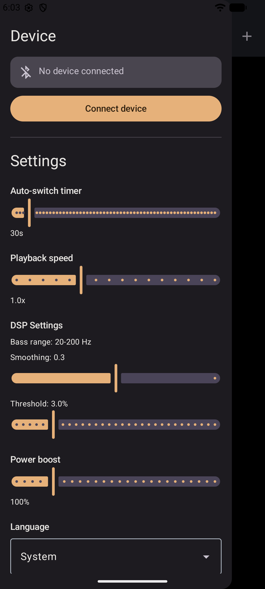 | 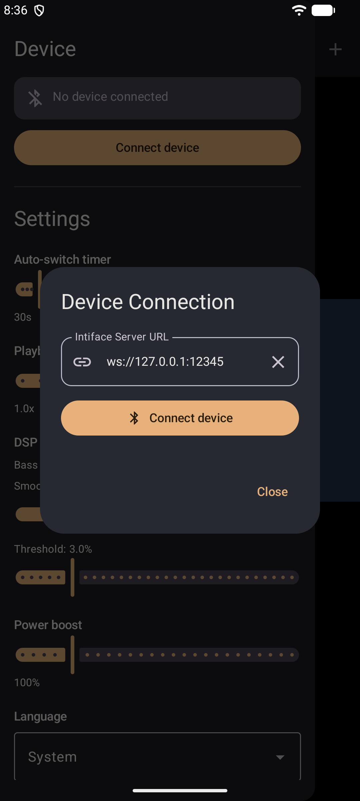 | 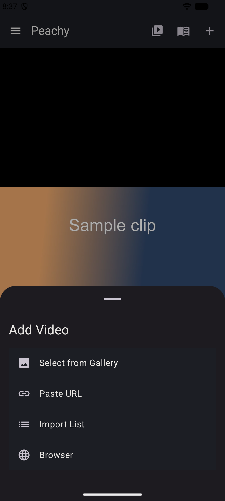 |

| Галерея | Сжатие | Заметка |
|:---:|:---:|:---:|
| 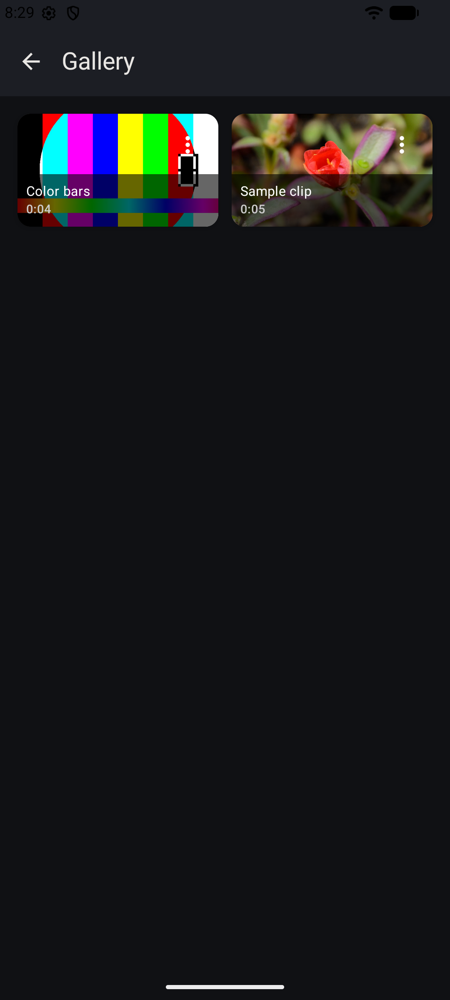 | 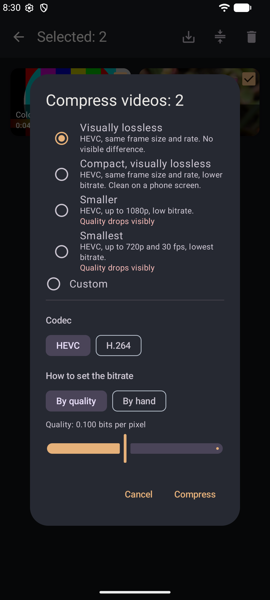 | 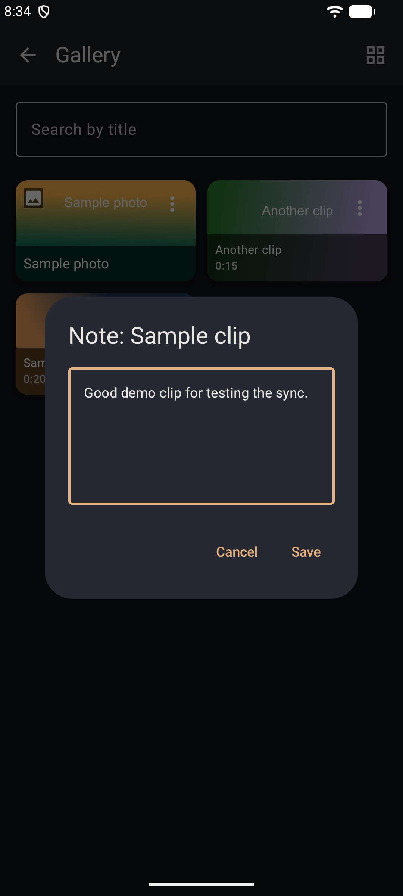 |

| Раскладка галереи | Загрузка | Ещё настройки |
|:---:|:---:|:---:|
| 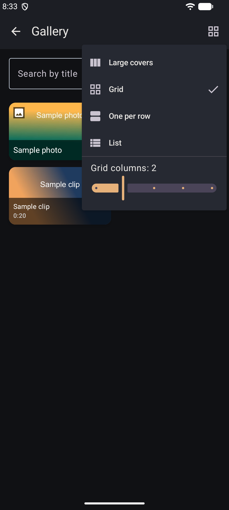 | 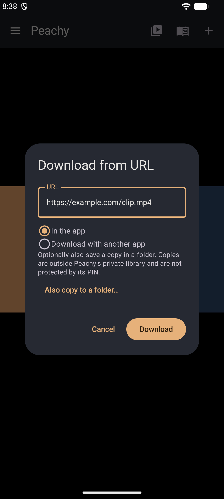 | 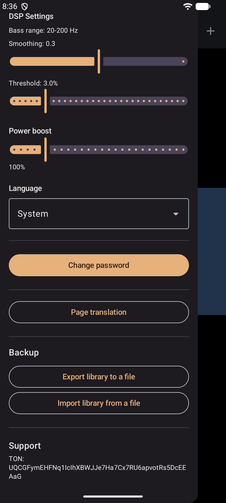 |

### Браузер и резервная копия

| Стартовая страница | Видео на странице | Резервная копия |
|:---:|:---:|:---:|
| 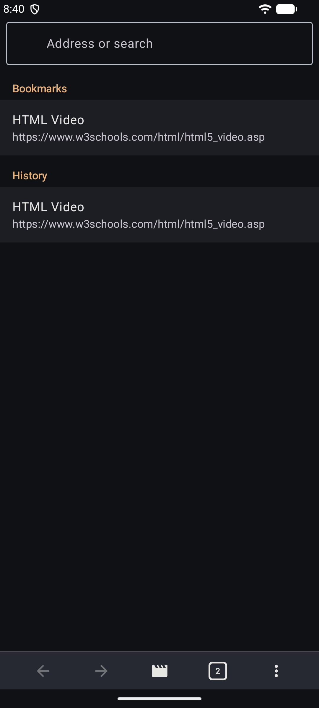 | 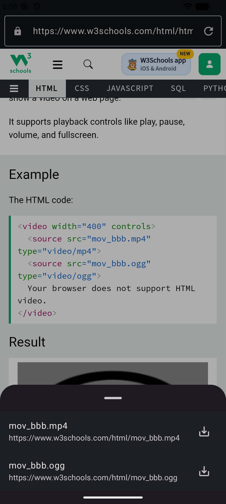 | 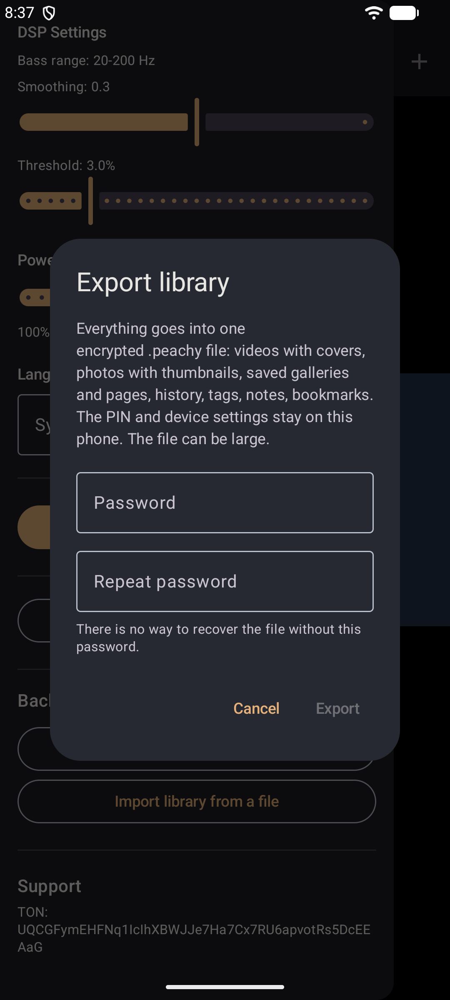 |

| Меню браузера |
|:---:|
| 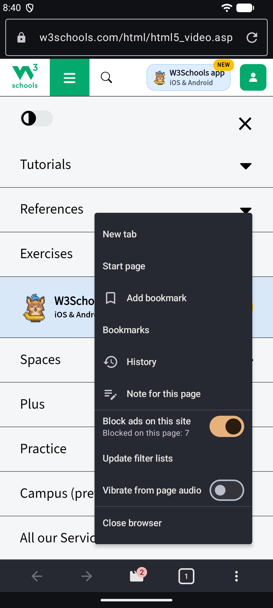 |

### Манга

| Каталог | Меню | Теги | Ридер |
|:---:|:---:|:---:|:---:|
| 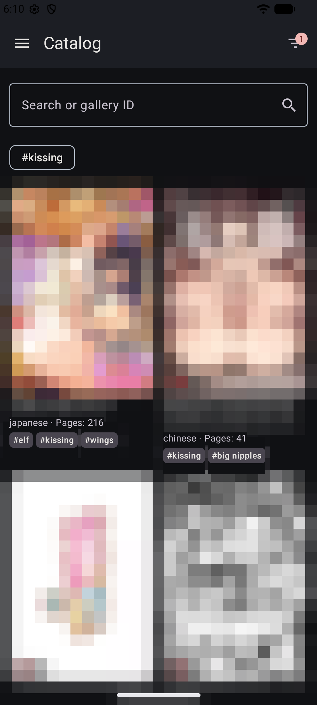 | 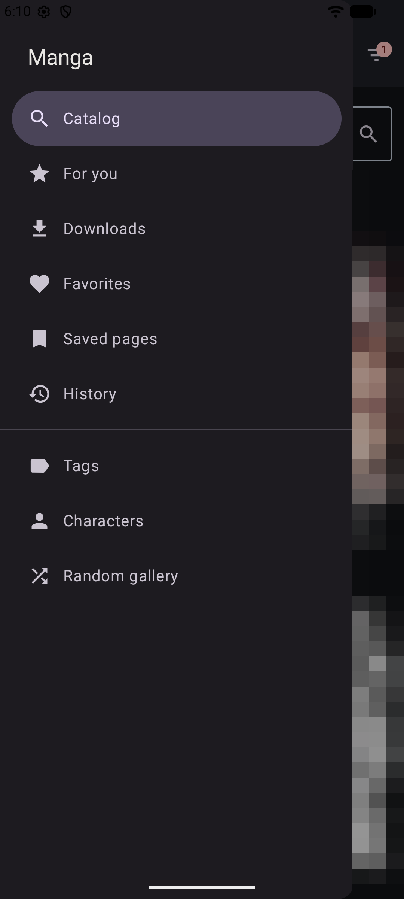 | 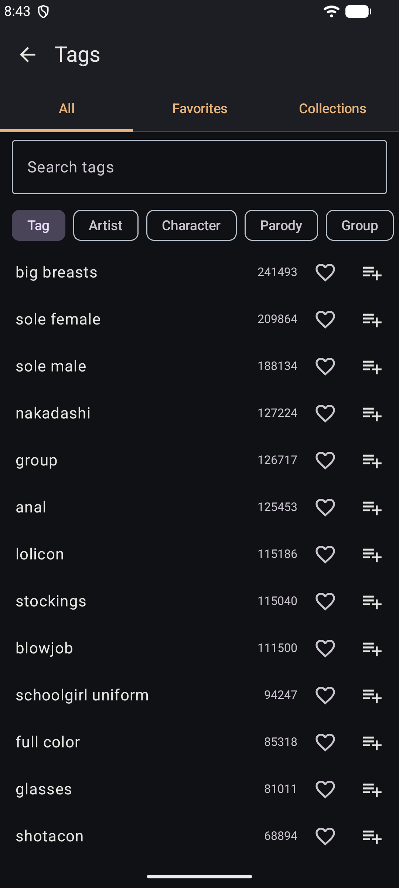 | 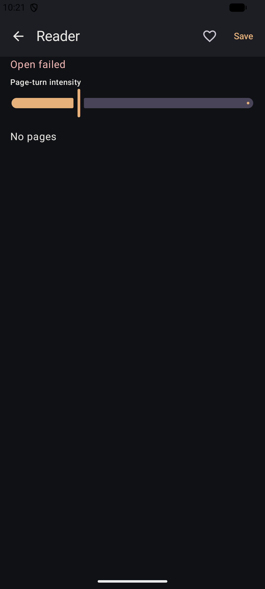 |

| Провайдер перевода страниц |
|:---:|
| 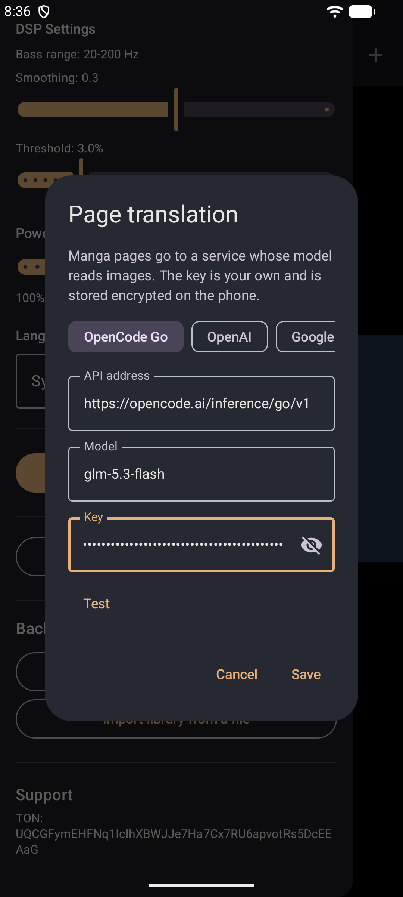 |

## Подробности

- Воспроизводит локальное видео через Media3 ExoPlayer. Карусель миниатюр показывает настоящую очередь и выделяет текущий ролик. Горизонтальный свайп по видео перематывает его; двойное касание левой/правой половины — −10/+10 секунд. Вертикальный свайп у левого/правого края меняет яркость окна/громкость медиа. Щипок увеличивает, перетаскивание увеличенного видео сдвигает кадр, долгое касание сбрасывает масштаб. Свайп по карусели только прокручивает очередь.
- Поиск находится в шапках галереи, плеера и каталога манги. Поиск медиа по названию не учитывает регистр; сортировка — по дате добавления, имени и весу в обоих направлениях. Границы веса включительные, вводятся в МиБ. Поиск и фильтры плеера меняют очередь. В каталоге манги сохранён переход по ID галереи.
- Вкладки галереи «Все», «Видео», «Фото», «Альбомы» переключаются горизонтальным свайпом. Карточки показывают вес файлов. Оба типа медиа можно переименовывать и удалять по одному или смешанным выделением; фото открывается в просмотрщике с зумом, сдвигом и учётом EXIF, а не в плеере. Сжатие и выгрузка в папку доступны только для видео.
- Фото или видео входит максимум в один альбом. Альбомы можно создавать и переименовывать; отдельные медиа и смешанное выделение — переносить между ними или в «Без альбома». Удаление альбома не удаляет его файлы из библиотеки.
- Принимает одно или несколько фото и видео через Android «Поделиться». Фото копируются во внутреннее хранилище приложения, проверяются декодированием размеров изображения и получают уменьшенную миниатюру. Лимит одного фото — 100 МиБ, в том числе если отправитель не сообщает размер; некорректные изображения отклоняются. Отсутствующие и необычные названия не используются как пути хранения.
- Меню вида галереи запоминает стиль обложек и дискретный размер плиток: 1–5 колонок. Изменение сразу применяется к сетке; режимы «По одной в ряд» и «Список» остаются одноколоночными, сохраняя настройку сетки.
- Скачивает видео по `http` или `https` в библиотеку приложения.
- Импортирует видео по ссылкам файлообменников: альбом или один файл на Bunkr, Cyberdrop, Turbo, Pixeldrain и Filester, а также страница альбома findr.to (импортируется альбом, на который она ведёт). Ссылка на альбом приносит все видео из него, картинки и архивы пропускаются. Работают только открытые ссылки: альбомы с паролем, GoFile и FileDitch не поддерживаются. CDN Turbo не открывался с тестовой машины, поэтому загрузка с Turbo не проверена.
- Выгружает выбранные ролики из галереи в папку, которую вы выберете. Приложение получает доступ только к этой папке, а неудавшаяся копия удаляется, а не остаётся недописанной.
- Сжимает отдельное видео из его меню, выделенные ролики или отфильтрованные видео галереи через Media3 Transformer. Четыре пресета либо свои кодек, битрейт, высота, частота кадров и звук; до запуска видна оценка размера. Если выход HEVC не поддерживается, используется H.264. Оригинал заменяется только более компактным результатом после проверки размера, длительности и звука. Отмена сохраняет оригинал.
- Открывает HTTPS-страницу во WebView и берёт её звук для вибрации. Окно помечено `FLAG_SECURE`. Адрес не по HTTPS отклоняется.
- Есть встроенный браузер с вкладками, закладками, историей и блокировщиком рекламы и трекеров. Блокировщик использует списки EasyList, EasyPrivacy и список для взрослых сайтов, они лежат в приложении; пункт «Обновить списки фильтров» в меню загружает свежие. Для сайта блокировку можно отключить. Браузер показывает видеофайлы, которые загрузила страница, и сохраняет выбранный в библиотеку; потоки HLS и DASH сохранить нельзя. Страницы открываются только по HTTPS.
- Переводит страницу манги в нативном ридере с помощью vision-языковой модели, которую вы выбираете, через OpenAI-совместимый API `chat/completions` (по умолчанию адрес OpenCode Go и модель `glm-5.3-flash`; одним касанием подставляются адрес и недорогая модель для OpenCode Go, OpenAI, Google Gemini, OpenRouter и Mistral; адрес, модель и ключ задаются в «Настройки», «Перевод страниц», или из панели). Кнопка в шапке ридера отправляет текущую страницу, результат показывается в панели над нижней частью страницы: каждая реплика с переводом, оригиналом и пометками для звукоподражаний. Режим выбирается в настройках ридера: по запросу, при каждом перелистывании или вся галерея с прогрессом и кнопкой «Отмена». Язык перевода - язык приложения (язык устройства, если выбрано «Системный»); в настройках ридера можно выбрать язык оригинала (Авто, японский, китайский, корейский, английский), язык перевода и способ поиска текста: модель находит текст сама (лучше всего с сильной vision-моделью) или ML Kit находит его на устройстве, и провайдеру уходит только распознанный текст (латиница, японский, китайский, корейский; добавляет около 15-30 МБ). Пункт «Показывать на странице» рисует каждую реплику на белой плашке поверх оригинала; плашки двигаются вместе с масштабом и сдвигом. Переводы кэшируются по галерее, странице и языку в зашифрованной базе и переезжают в файл `.peachy`, поэтому за страницу платите один раз. Ответ 401, 403 или 429 останавливает пакет без повторов.
- Отправляет изображения страниц только на введённый вами адрес провайдера и только после согласия в окне, где указан хост. При смене хоста согласие спрашивается заново. Обычный `http` принимается только для localhost и частных сетей. Ключ лежит на телефоне в зашифрованном виде (`EncryptedSharedPreferences`), не попадает ни в базу, ни в файл `.peachy`, ни в резервную копию и не пишется в журнал. Контент для взрослых отправляется как есть: провайдер может отказаться читать часть страниц, панель об этом скажет.
- Хранит личную заметку к ролику, сохранённой галерее или странице в браузере. Заметки лежат в зашифрованной базе и никуда не отправляются.
- Выгружает и загружает библиотеку в файле `.peachy` под паролем: медиа и миниатюры, альбомы, сохранённую мангу и страницы, истории, теги и чёрный список, заметки, данные браузера и переводы. AES-256-GCM, ключ PBKDF2-SHA256; файлы обрабатываются блоками. Формат 3 читает форматы 1 и 2. ID альбомов переназначаются; совпадения имени и времени создания сопоставляются один к одному, поэтому разные одноимённые альбомы не сливаются. Существующие дубликаты медиа сохраняют свой альбом. Загрузка добавляет, а не удаляет; побеждают более новые заметки и переводы. Дубликаты фото определяются по названию, размерам в пикселях и весу. Пароль приложения, настройки устройства и ключ провайдера остаются на телефоне. Забытый пароль резервной копии восстановить нельзя.
- Подключается к Intiface Central по WebSocket. Адрес по умолчанию: `ws://127.0.0.1:12345`. Само приложение Bluetooth не сканирует: это делает Intiface.
- Ведёт амплитуду через один DSP: диапазон низких частот, сглаживание, порог и усиление. Настройки общие для плеера и WebView.
- Шлёт команды только актуаторам, которые могут следовать за уровнем звука: вибрация, осцилляция, вращение, позиция.
- Переключает ролики по таймеру и меняет скорость воспроизведения.
- Закрывает приложение непустым паролем без обрезки пробелов и ограничения длины; прежний PIN продолжает работать. Смена — в настройках. Ошибки увеличивают паузу перед повтором. Экраны входа, задания и смены пароля прокручиваются с клавиатурой и помещаются в ландшафте. Пересоздание при повороте сохраняет разблокировку; реальный уход в фон блокирует сессию.
- Интерфейс тёмный, на русском и английском.
- Показывает nhentai в хабе с боковым меню: Каталог, Загрузки, Избранное, История, Теги, Персонажи и Случайная галерея. Каталог — сетка из двух колонок с обложками и чипами тегов, фильтры по тегу (включить или исключить), дате и числу страниц, сортировка по дате или популярности. Браузер тегов показывает теги, художников, персонажей, пародии, группы, категории и языки по популярности; теги можно отметить избранными, собрать в именованные подборки, которые хранятся на устройстве, и отправить в каталог как поиск. На странице галереи — названия, число страниц, число избранных, дата загрузки, теги по типам, похожие галереи и комментарии только для чтения, которые подгружаются по запросу. Писать комментарии нельзя: для этого нужен аккаунт nhentai. Галереи открываются в нативном ридере на Compose, их можно сохранить на устройство и отметить избранными. Картинки запрашиваются с `i1.nhentai.net` и `t1.nhentai.net`; путь из ответа API не переписывается. Листание даёт короткий импульс. Сила импульса при листании задаётся в панели настроек ридера, а не ползунком на странице.
- В каталоге кнопка «Фильтры» стоит в шапке и показывает число активных тегов. Нажатие на тег на карточке переключает его по кругу: включить, исключить, убрать, в том же порядке, что и чипы под строкой поиска; долгое нажатие делает тег избранным и подсвечивает его на всех карточках. Следующая страница подгружается при прокрутке к концу списка, а при ошибке показывается кнопка «Повторить», без бесконечных перезагрузок.
- В русском интерфейсе теги, категории и языки галерей показываются по-русски: встроенный словарь покрывает теги, которые есть не меньше чем у 500 галерей, остальные названия остаются английскими. Поиск, фильтры, избранное и подборки тегов всегда используют английские названия из API, поэтому смена языка меняет только то, что нарисовано на экране.
- Подбирает галереи во вкладке «Для вас», считая всё на устройстве. Учитываются открытые, прочитанные, сохранённые и избранные галереи, избранные теги и подборки тегов, а также нажатия «Не интересно»; старые сигналы со временем теряют вес. Кандидаты берутся из поиска nhentai по самым любимым тегам и из списков похожих галерей, которые вам понравились; у каждой подборки показаны теги, из-за которых она попала в список. Пока вкусов нет, вкладка показывает популярное. Дата загрузки на карточке есть только у галерей, страницу которых приложение уже открывало: в результатах поиска её нет. История использует те же крупные карточки, что и каталог. На странице галереи под тегами — сетка превью страниц, нажатие открывает ридер на этой странице.
- Встроенный ридер листает касанием левой или правой трети экрана (в вертикальном постраничном режиме — верхней и нижней трети; в непрерывной ленте остаются левая и правая); середина открывает шапку с названием, ленту миниатюр страниц и настройки. Настройки: направление чтения (вертикально или горизонтально), вписывание (страница целиком или по ширине), непрерывная прокрутка, листание касанием с заменой левой и правой стороны для управления одной рукой, кнопки масштаба и скрытие подсказок касаний, которые показываются при открытии. Щипок, двойное касание и кнопки масштаба увеличивают страницу до 6×, следующие три страницы подгружаются заранее. Ридер продолжает с последней прочитанной страницы. Кнопка закладки в шапке сохраняет отдельный лист; вкладка «Сохранённые листы» показывает такие листы, открывает ридер на выбранном, выгружает или удаляет выбор. Выгрузка идёт в папку, которую вы выберете; доступ приложение получает только к ней.

- Раздел Support в настройках копирует Sol-адрес `FB4B37LCd52dgVED5fR7Vj7CDttsa74CQyBc647agQP7`; кнопка GitHub открывает [spgsroot/Peachy](https://github.com/spgsroot/Peachy). Масштабируемый исходник логотипа — `repo/logo.svg`, из него экспортированы иконки, заставка и баннеры.
- Проверки и ограничения эмулятора: [отчёт ручного прогона](docs/reports/2026-11-14-usability.md).

Ключ nhentai вшит в клиент и уходит только в заголовке `Authorization`. Он лежит в публичном исходнике и читается из APK. В release-сборке minify выключен.

## Требования

- minSdk 26, targetSdk 36
- JDK 17 и Android SDK для локальной сборки
- Intiface Central, если устройство должно двигаться

## Сборка

```bash
./gradlew :app:assembleDebug
```

`assembleRelease` даёт неподписанный APK. Подпись делает GitHub Actions в `.github/workflows/release.yml`, из секретов репозитория. Запуск — по тегу `v*` или вручную. Файла `LICENSE` в этом дереве нет.
