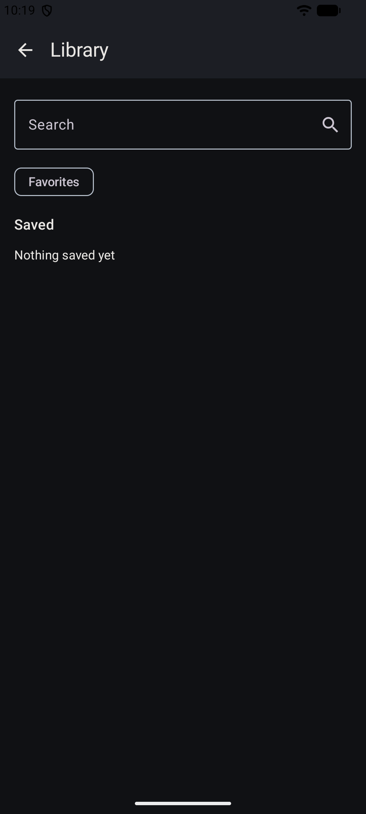

# VibePlayer

Видеоплеер для Android, который переводит звук воспроизведения в команды актуаторов Buttplug, и ридер nhentai. Интерфейс на Jetpack Compose. Версия в этом дереве: `2.3.0` (`versionCode` 3). [English](README.md).

Снимки сделаны на эмуляторе с пустой библиотекой. Видео и страницы галерей не загружались.

| Первый запуск | PIN | Плеер |
|:---:|:---:|:---:|
|  |  |  |

| Настройки | Устройство | Добавление видео |
|:---:|:---:|:---:|
|  |  |  |

| Галерея | Библиотека | Ридер |
|:---:|:---:|:---:|
|  |  |  |

Снимок ридера — экран после неудачного открытия. Изображений страниц на нём нет.

## Что делает

- Воспроизводит локальное видео через Media3 ExoPlayer. В галерее можно переименовать ролик, сменить обложку и удалить один или несколько.
- Скачивает видео по `http` или `https` в библиотеку приложения.
- Открывает HTTPS-страницу во WebView и берёт её звук для вибрации. Окно помечено `FLAG_SECURE`. Адрес не по HTTPS отклоняется.
- Подключается к Intiface Central по WebSocket. Адрес по умолчанию: `ws://127.0.0.1:12345`. Само приложение Bluetooth не сканирует: это делает Intiface.
- Ведёт амплитуду через один DSP: диапазон низких частот, сглаживание, порог и усиление. Настройки общие для плеера и WebView.
- Шлёт команды только актуаторам, которые могут следовать за уровнем звука: вибрация, осцилляция, вращение, позиция.
- Переключает ролики по таймеру и меняет скорость воспроизведения.
- Закрывает приложение PIN из 4 цифр. Повторные ошибки увеличивают паузу. База зашифрована SQLCipher.
- Интерфейс тёмный, на русском и английском.
- Ищет nhentai, сохраняет галерею на устройство и отмечает избранное. Картинки запрашиваются с `i1.nhentai.net` и `t1.nhentai.net`; путь из ответа API не переписывается. Листание даёт короткий импульс. Силу задаёт ползунок в ридере.

Ключ nhentai вшит в клиент и уходит только в заголовке `Authorization`. Он лежит в публичном исходнике и читается из APK. В release-сборке minify выключен.

## Требования

- minSdk 26, targetSdk 36
- JDK 17 и Android SDK для локальной сборки
- Intiface Central, если устройство должно двигаться

## Сборка

```bash
./gradlew :app:assembleDebug
```

`assembleRelease` даёт неподписанный APK. Подпись делает GitHub Actions в `.github/workflows/release.yml`, из секретов репозитория. Запуск — по тегу `v*` или вручную. Файла `LICENSE` в этом дереве нет.
